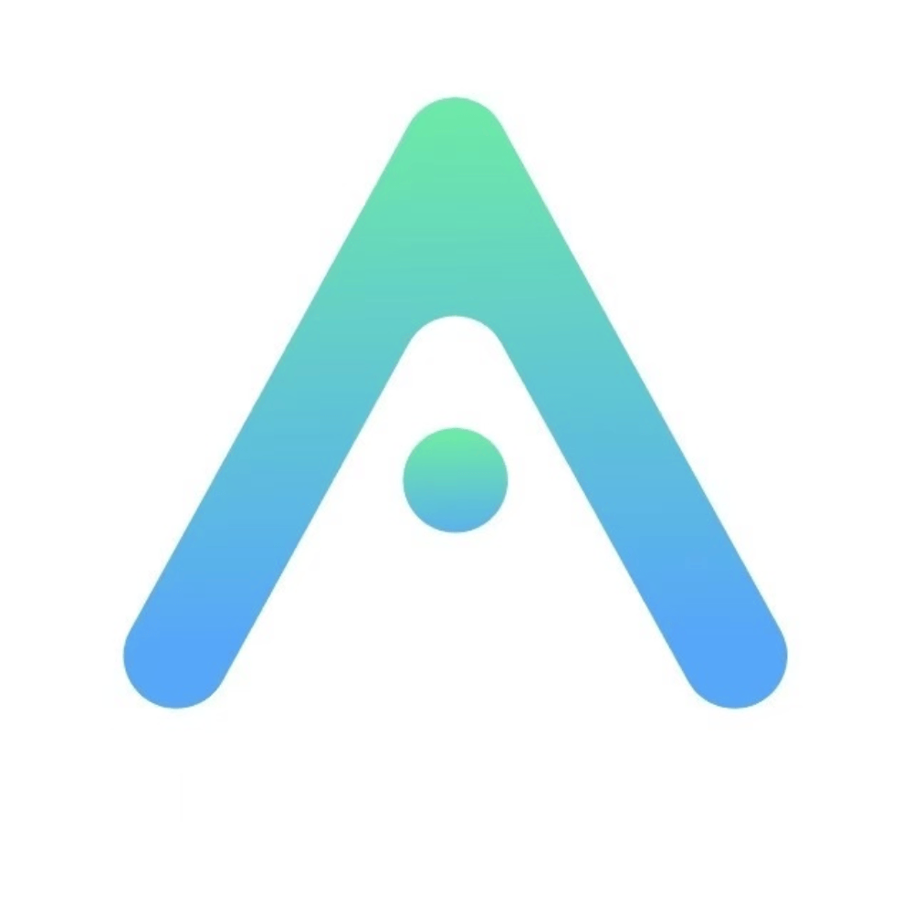

# Use Ace Data Cloud tools in Zed

Choose the services you need for your project. For example, use Google Search to collect sources for a design note, recognize text in a screenshot, or retrieve a media task to insert its result into documentation.

[Local settings](local.settings.json) cover 27 public services. [Hosted settings](remote.settings.json) cover 25. Image to Text and Digital Human run locally through their published Python packages. Copy the entries you want into your existing `context_servers` settings.

### Search, chat and utilities

| | Service | Settings key | Example |
| --- | --- | --- | --- |
|  | Google Search | `ace-google-search` | Search for sources using Google web, image, map or news results. |
|  | AI Chat | `ace-aichat` | Create conversations and send messages across supported chat models. |
|  | Grok | `ace-grok` | Chat with Grok or generate video from text or an image. |
|  | GLM | `ace-glm` | Send chat completions to GLM models. |
|  | Image to Text (local only) | `ace-image2text` | Recognize text in images. |
|  | Short URL | `ace-shorturl` | Create short URLs individually or in batches. |
|  | Web Extractor | `ace-webextrator` | Extract or render web pages and retrieve completed tasks. |

### Music and speech

| | Service | Settings key | Example |
| --- | --- | --- | --- |
|  | ACE Music | `ace-music` | Generate music and retrieve existing audio tasks. |
|  | Suno | `ace-suno` | Generate, extend or cover songs and look up prior tasks. |
|  | Producer | `ace-producer` | Generate music, extend tracks or make a cover. |
|  | Fish Audio | `ace-fish` | Generate speech with Fish Audio and retrieve audio tasks. |

### Images and 3D

| | Service | Settings key | Example |
| --- | --- | --- | --- |
|  | Nano Banana | `ace-nano-banana` | Generate or edit an image. |
|  | GPT Image | `ace-gpt-image` | Generate or edit an image. The hosted OpenAI endpoint exposes its additional tools. |
|  | Seedream | `ace-seedream` | Generate, edit or decompose images. |
|  | FLUX | `ace-flux` | Generate or edit images, or create video with supported FLUX models. |
|  | Qwen Image | `ace-qwen-image` | Generate or edit images with Qwen Image. |
|  | Tripo | `ace-tripo` | Generate a 3D asset and retrieve the finished model. |

### Video

| | Service | Settings key | Example |
| --- | --- | --- | --- |
|  | Seedance | `ace-seedance` | Generate a video from text or an image. |
|  | Kling | `ace-kling` | Generate videos with assets, motion control or lip sync. |
|  | Veo | `ace-veo` | Generate a video from text or an image and retrieve higher-resolution output. |
|  | Hailuo | `ace-hailuo` | Generate a video from text or an image with Hailuo. |
|  | HappyHorse | `ace-happyhorse` | Generate a video from references or edit an existing video. |
|  | Luma | `ace-luma` | Generate or extend video with Luma. |
|  | MiniMax | `ace-minimax` | Generate video from text, an image or supported audio inputs. |
|  | Wan | `ace-wan` | Generate video from text or reference media. |
|  | Digital Human (local only) | `ace-digitalhuman` | Create a talking-character video and retrieve an existing task. |
|  | Maestro | `ace-maestro` | Create a composed video and retrieve existing productions. |

## Use Claude Messages and other chat models

Choose `ace-aichat` for chat. The `aichat_create_message` tool calls Claude's native `/v1/messages` endpoint. Use a General application token with access to Claude Messages, then supply a `model`, `messages` and `max_tokens`. The [native Messages guide](../aichat/README.md#native-messages-including-claude-55) includes an example.

For a conversation with Gemini, Kimi or DeepSeek, use `aichat_create_conversation_v2` in the same server. Choose a supported model from the tool's `model` field. These requests use the AiChat conversation API and its application permissions.

## Connect a hosted server

1. Open **Settings → AI → MCP Servers** in Zed. Choose **Add Server → Add Remote Server**.
2. Copy the `url` for the service you want from [the hosted examples](remote.settings.json). Give it the corresponding settings key. You can also merge that one entry into `context_servers` in your existing Zed settings.
3. Follow the service's OAuth prompt. If you already have an application key for that service, you can instead supply `Authorization` with the value `Bearer YOUR_SERVICE_KEY` in the remote server's headers. Keep keys in your personal settings.
4. Check for the **Server is active** indicator and inspect the server's tools. Use an existing task ID with a task lookup tool to retrieve an earlier result. Starting a generation or running a search requires the matching application and may spend credits.

The hosted OpenAI endpoint exposes its full tool list. For a toolset restricted to GPT Image, use the local profile below.

## Run a published package locally

Install [uv](https://docs.astral.sh/uv/getting-started/installation/) and copy the entry for one service from [the local examples](local.settings.json) into your Zed `context_servers`. Set `ACEDATACLOUD_API_TOKEN` in the environment used to launch Zed, or add it to the selected server's `env` object in your personal settings. Use a key that has access to that service. `ace-gpt-image` starts the published OpenAI package with `--profile gpt-image`, exposing only the image tools. If `uvx` is not on Zed's PATH, use its absolute path for `command`.

[Manage service applications](https://platform.acedata.cloud/console/applications?utm_source=github&utm_medium=referral&utm_campaign=evergreen) · [Service pricing](https://platform.acedata.cloud/models?utm_source=github&utm_medium=referral&utm_campaign=evergreen) · [Zed MCP settings](https://zed.dev/docs/ai/mcp#as-custom-servers)
